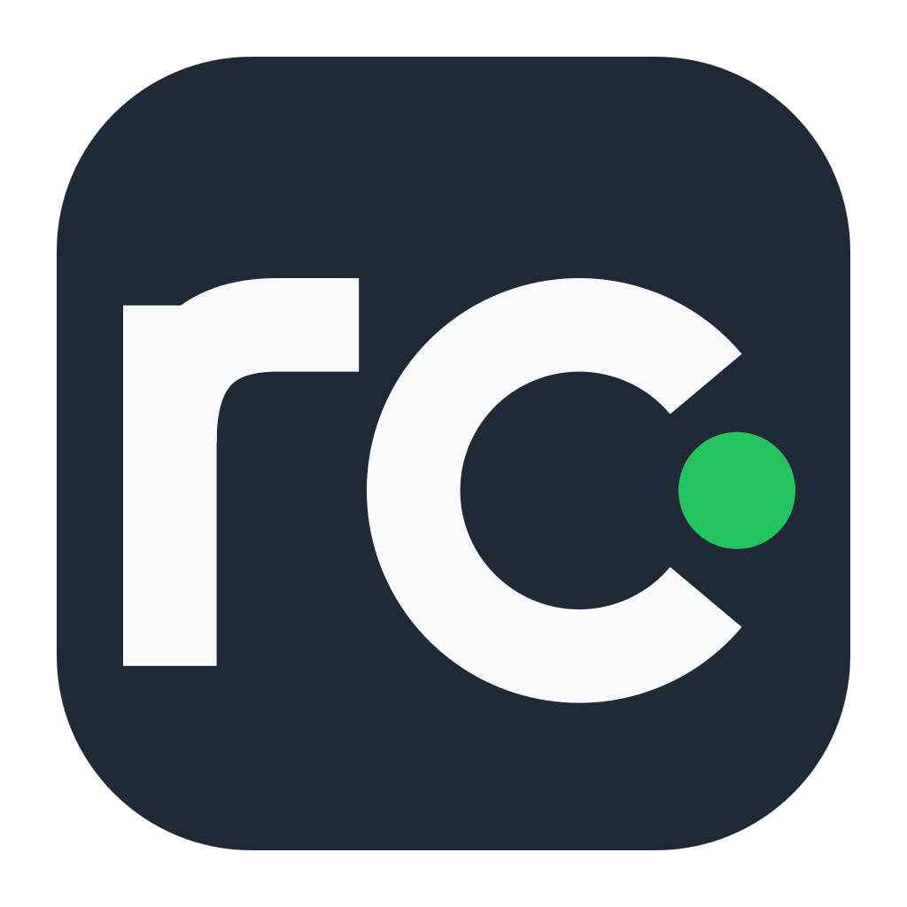
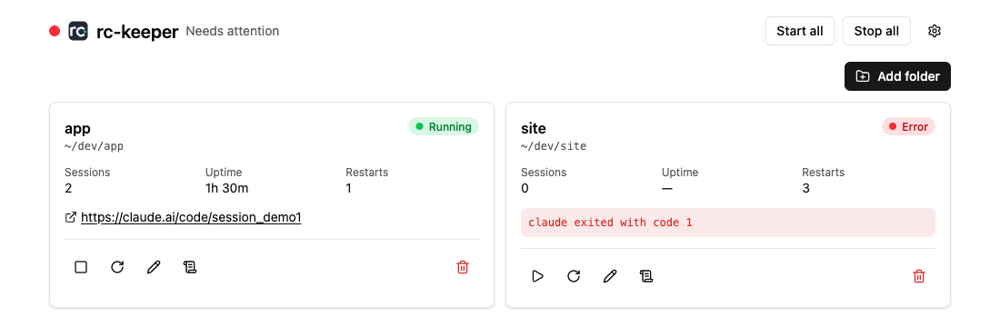

<p align="center"></p>

# rc-keeper

rc-keeper keeps `claude remote-control` running 24/7. It runs one server for each folder you choose.

It is for developers who use Claude Code remote sessions on more than one project. It works on a desktop or on a headless server.

rc-keeper is unofficial. It is not affiliated with Anthropic.



## Install

macOS or Linux:

```sh
curl -fsSL https://raw.githubusercontent.com/tupe12334/rc-keeper/main/install.sh | sh
```

Windows (PowerShell):

```powershell
irm https://raw.githubusercontent.com/tupe12334/rc-keeper/main/install.ps1 | iex
```

## Features

- Runs many folders at once. Each folder has its own flags and restarts with backoff.
- Desktop app with a tray icon, status, logs, and launch at login.
- Command-line tool for servers over SSH: `rc-keeper status --json`.

## Install guides

- [macOS](docs/install/macos.md)
- [Linux](docs/install/linux.md), including servers over SSH
- [Windows](docs/install/windows.md)
- [How it works](docs/how-it-works.md)
- [CLI reference](docs/reference/cli.md)
- [IPC reference](docs/reference/ipc.md)

## Security

Remote sessions started from claude.ai or your phone can read, edit and run files in the instance folder. They use the permission mode you chose for that folder.

- `bypassPermissions` skips all prompts. Use it only in folders you trust.
- "Trust this folder automatically" answers the folder trust prompt for you.
- Pick folders and modes with care. Prefer project folders over your home folder.

## Contributing

See [CONTRIBUTING.md](CONTRIBUTING.md).

## License

MIT. See [LICENSE](LICENSE).
